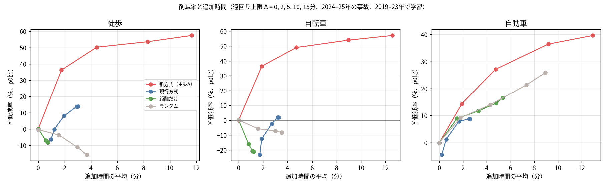
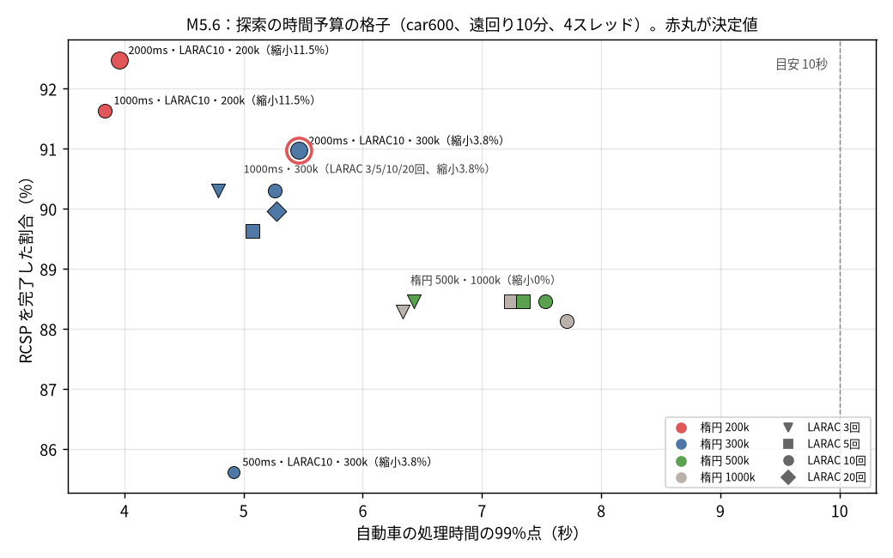
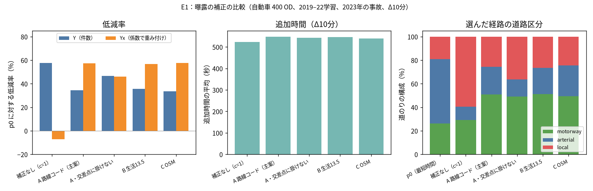
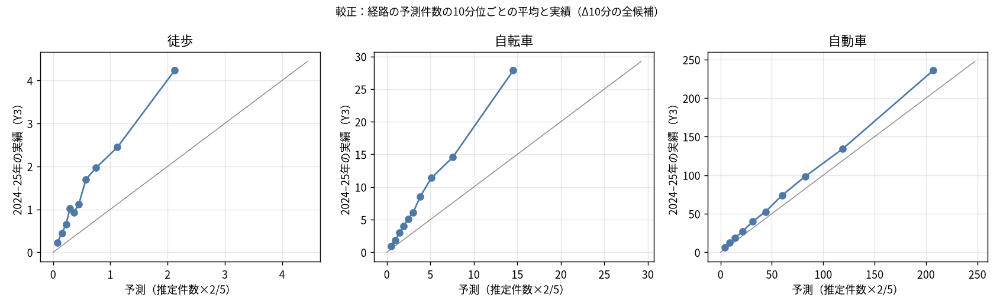
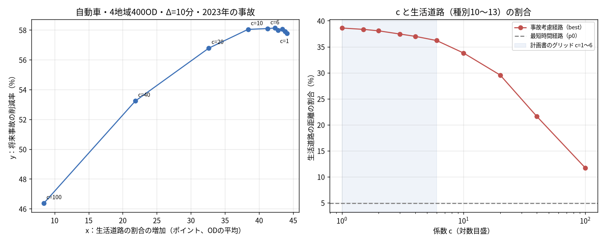

# M5 完了報告：評価と係数の決定

- ブランチ：`feat/routing-m5`（`feat/routing-m4` から切った。push・PRはしていない）
- 作業役：DeepSeek V4.1 Flash（`dsh-flash`、`data/work/M5/tasks/launch.sh`）。タスクごとに子ブランチと worktree（`data/work/wt/m5-*`）で実装させた。指示役が差分を読み、fmt・clippy（`-D warnings`）・`cargo test --locked` で確かめてからコミット・統合した。Flash が `.git` を書き換えていないこと（`.git` の指す先、`.git-local` がないこと）を毎回確かめた。
- 実験のスクリプトと生データ：`data/work/M5/`（`scripts/`、`e1/`、`budget/`、`eval/`、`m58/`、`release/`）。図：`docs/routing-reports/M5/`。

## 0. 1ページのまとめ

### 0.1 新方式と現行方式（2019〜2023年で学習、2024〜2025年の事故で評価、遠回りの上限10分）

4地域（東京23区・千葉市・さいたま市・横浜市）×各100 OD。削減率は最短時間経路（p0）に対する将来事故 Y（Y1・Y2・Y3 の平均）の減り方。括弧は OD 単位のクラスターブートストラップの95%区間。

**主な物差し**：自動車は Yx（事故1件ごとに道路区分の係数で重みを付けた Y）、徒歩・自転車は Y（係数を掛けないので Yx と同じ）。利用者の判断（2026-11-05）で、国交省の区分別の事故率を交通量の代わりとして正しいと認め、自動車は Yx を優先することにした（10章の2）。下の表の Y は件数の値で、自動車では参考。

| 手段 | 方式 | Y 削減率 | 勝率（符号検定） | 追加時間の平均 | 生活道路の割合（p0→選定） | 選んだ経路の Y が p0 より多い OD |
|---|---|---|---|---|---|---|
| 徒歩 | **新方式** | **53.6%**（48.5〜58.4） | **80.1%** | +498秒（+8.3分） | 46.3%→60.7% | 16.5% |
| 徒歩 | 現行方式 | 13.8%（7.3〜19.8） | 57.0% | +175秒（+2.9分） | 46.3%→52.7% | 30.0% |
| 自転車 | **新方式** | **53.9%**（51.1〜56.6） | **91.0%** | +538秒（+9.0分） | 45.7%→70.6% | 8.8% |
| 自転車 | 現行方式 | 1.8%（−3.3〜7.2） | 50.6% | +191秒（+3.2分） | 45.7%→43.1% | 44.6% |
| 自動車 | **新方式** | **36.4%**（33.8〜39.1） | **92.8%** | +551秒（+9.2分） | 4.9%→24.2% | 7.2% |
| 自動車 | 現行方式 | 8.8%（5.5〜11.9） | 65.9% | +151秒（+2.5分） | 4.9%→7.7% | 29.8% |

自動車の主な物差し Yx（係数は2019〜2023年の推定：自専道0.2587・幹線1・生活14.91）：

| 方式 | Yx 削減率 | 勝率（Yx、符号検定） | 選んだ経路の Yx が p0 より多い OD |
|---|---|---|---|
| **新方式** | **60.7%**（58.2〜63.0） | **91.7%** | 8.3%（33/400） |
| 現行方式 | −24.0%（−31.3〜−17.0） | 32.6% | 59.0%（236/400） |

- 自動車の主な物差し Yx で、新方式は60.7%減、現行方式は24.0%増だった（現行方式は p0 より悪い）。Yx は新方式と同じ係数で重みを付けるので、新方式に有利な作りであることに注意（5章）。
- 徒歩・自転車でも、新方式は現行方式より Y を大きく減らした。代わりに追加時間は約3倍で、上限の10分近くまで使う（7章）。
- 遠回りの上限を2・5・15分にした曲線は図 `M5/m57-curve.png`。新方式は2分（追加約1.9分）で徒歩・自転車36%、自動車14%を減らす。



### 0.2 決めた値（計画書12.2節）

| 項目 | 決定 | 根拠 |
|---|---|---|
| 自動車の生活道路の係数 c | **計画書5.5節の c を、道路区分ごとの事故率による補正（曝露の補正）に置き換えた**（利用者の承認、`docs/routing-exposure-plan.md`）。自専道・幹線・生活の3区分の係数を、警察の路線コード・国交省の延長・H27の区分別の事故率から、学習期間の事故で計算する。本番（2019〜2025年）では**自専道 0.246、幹線 1、生活 14.85**。交差点クラスタには最上位の道路の区分の係数を掛ける | 4.2節（c の掃引では折れ目が定まらない、付録A）、5章（E1）、図 `M5/c-sweep.png`・`M5/e1-exposure.png` |
| σ0 | 3.5（変えない） | 2・5・7と比べた削減率の差が0.5ポイント以内で、区間がすべて0をまたぐ（4.1節） |
| 高リスク区間のしきい値 | **3件**（変えない） | 自動車の選定経路の区間数の中央値が3件で10、2件で13。11区間以上の経路が49%→56%に増える。徒歩は9割超が0区間でどちらでも同じ（4.3節、8.3節） |
| 探索の時間予算 | **RCSP 2,000ms、LARAC 10回、楕円 300,000ノード**（ラベル上限 2,000,000 は既定のまま） | 自動車の99%点が10秒以下の組み合わせのうち、縮小が1割未満で RCSP の完了率が最大（6章、図 `M5/m56-budget.png`） |



### 0.3 評価で分かった弱点

1. **自動車を生活道路へ誘導する。** 選んだ経路の生活道路（residential・unclassified・living_street・service）の割合が4.9%から24.2%に上がる（ODの平均で+26.9ポイント）。曝露の補正を入れない場合（38.9%）より小さいが、現行方式（7.7%）よりはっきり大きい。地域別では、さいたま市+37、千葉市+34、横浜市+20、東京23区+16ポイント（7.5節）。
2. **徒歩・自転車も裏道へ誘導する。** 生活道路の割合が、徒歩で46%→61%、自転車で46%→71%に上がる。計画書5.6節で予想した弱点がそのまま出た。歩行者・自転車の通行量のデータがないので、件数が少ないのが交通量の少なさのせいか、本当に安全なせいかは区別できない。
3. **物差しが中立でない。** Y（件数）は交通量の少ない道に流す方式に有利で、Yx（係数で重み付け）は作りの上で新方式に有利になる（5章）。曝露の補正を入れると Y の削減率は57.8%から36.4%に下がり、Yx は−3.8%から60.7%に上がる。どちらが正しいかはデータからは決められず、国交省の事故率を交通量の代わりと認めるかどうかで決まる。利用者の判断（2026-11-05）で国交省の事故率を正しいと認め、自動車の主な物差しを Yx とした。Yx での評価は、この前提が正しいことに依存する。
4. **追加時間が大きい。** 自動車の追加時間は最短時間の平均50%にあたる。遠回りの上限を使い切る傾向がある（Δ15分で+13分）。
5. **予測の件数は実績より少ない。** 予測の順序は実績とそろうが、件数は自動車で約1.2倍、徒歩・自転車で約2倍少なく出る（7.6節）。画面に出すモデルの値は「相対的な比較の値」として扱う必要がある。
6. **地域の差。** 自転車の削減率は東京23区だけ44.5%で、ほかの3地域（61〜66%）より低い。東京23区の自動車は、75組のうち14組が楕円の上限を超えて幹線だけの網で探し直しになる（6章）。
7. **評価の範囲**：関東の都市部4地域だけで、農村・山間部・積雪地の経路の質は確かめていない（計画書9.3節）。

## 1. やったこと

| 作業 | 内容 | コミット |
|---|---|---|
| 要素を外した比較の準備 | `accident-snap` に尤度表・交差点クラスタを外す引数 | `c178fac`（統合 `0ee9f72`） |
| route-batch の拡張 | 経路の記録（`--paths`）、探索の目的（`--objective risk\|length\|random`）、リスクの変形（`--risk-variant`）、探索の設定の引数 | `4d56208`（統合 `3292419`） |
| M5.1・M5.2 | 評価地域の行政界の取り出し（`admin-boundary`）、地域内で一様な OD の抽出（`od-sample`） | `a6d6cfe`（統合 `247dcc3`） |
| M5.5・M5.8 の道具 | エンジンを通した一括評価 `engine-batch`・`engine-summary` | `648f373`（統合 `605713a`） |
| M5.4 | 物差し Y1〜Y3（`y-metrics`）と現行方式の経路の写像（`match-routes`） | `a806999`（統合 `1ad2c6f`） |
| 曝露の補正の計画 | `docs/routing-exposure-plan.md`（利用者の承認済み） | `515b326` |
| 曝露の補正 | `risk-fit` の `--exposure-*`、`risk.bin` の `PARAMS.car_exposure`、エンジンでの係数の適用 | `46cb93e`（統合 `5672a98`） |
| Yx | `y-metrics` の `--exposure-factors`（Y1x〜Y3x） | `bd5ad49`（統合 `7fb3b82`） |
| M5.6 | `ENGINE_SEARCH_PARAMS` を決めた値にする | `f50404e` |
| M5.3 | 現行方式の経路の取得（`data/work/M5/scripts/fetch_current.py`。コードの変更なし） | — |

テスト：`cargo test --locked` は749件成功・失敗0（M4の698件から51件増）。既存のテストは消しておらず、期待値も変えていない。`SearchParams::DEFAULT` も変えていない（エンジンが使う値は別の定数 `ENGINE_SEARCH_PARAMS`）。

## 2. 受け入れ条件

| 条件 | 結果 | 判定 |
|---|---|---|
| 計画書12.2節の3項目が値として決まっている | c は曝露の補正に置き換え（利用者の承認）、しきい値3件、時間予算 2000ms・10回・30万ノード。計画書12.2節に書いた | 合格 |
| M5.7 の報告が、指標・比較対象・要素を外した比較・較正のすべてについて揃っている | 7章 | 合格 |
| M5.8 で合法性の違反が0件 | 全国・関東の1,800組、5,344本の候補で違反0件（8.1節） | 合格 |
| M5.9 の release で M4 の受け入れ条件が満たされる | 検証コマンド、実データの300件、起動時間と RSS、`/api/route` の200を確かめた。M4.7 の docker build はやり直していない（9章） | 合格（docker build を除く） |

## 3. 評価の条件

- **地域と OD（M5.1・M5.2）**：OSM の行政界 relation（東京23区、千葉市、さいたま市、横浜市）を全国 PBF から取り出し、地域内の道路ノード（motorway を除く）から一様に抽出した。距離帯は徒歩0.5〜3km、自転車1〜8km、自動車2〜30km。1地域・1手段あたり100組、計1,200組（`data/work/M5/ods/all.jsonl`）。人口のデータがないので、計画書の「人口密度で重み付け」の代わりに一様抽出とした。
- **現行方式（M5.3）**：2019〜2023年の事故だけで `prepare_release` を使って作った schema 2 の release（`data/work/M5/base2023/`）と、M1 の関東の OSRM でサーバを起動し、`/api/route` の選定結果を取った。6,000件（1,200組×Δ5通り）のうち5,995件が成功し、失敗は OSRM が経路を返さなかった自転車の1組（Δ5通り分）。
- **物差し（M5.4）**：Y1 は経路から15m以内の将来事故、Y2 は距離だけで最寄りの辺に割り当てた将来事故（過去の実験のマップマッチングの代わり）、Y3 は M2b の割り当てで通過した辺・交差点に載る将来事故。主な物差し Y は3つの平均。
- **Yx（参考）**：事故1件ごとに、その事故が載る道路区分の係数（自専道0.2587・幹線1・生活14.91、2019〜2023年の推定の値）で重みを付けた Y。自動車だけ。徒歩・自転車では Y と同じ。
- **x**：生活道路（OSM の residential・unclassified・living_street・service）を走る距離の割合が、p0 と比べて何ポイント増えたか（OD の平均）。
- **区間**：OD 単位（地域で層別して OD を復元抽出、2,000回）と地域単位（4地域を復元抽出）。
- **時間**：表示の所要時間は共通の時間モデル（`jp-time-2`）で測り直した。

### 3.1 注記

- **東京23区の偏り**（計画書9.2節）：過去の実験は東京23区で現行方式を調整しているので、東京23区の現行方式の結果は有利に出ている可能性がある。
- **現行方式の release の2024・2025年の行**：`prepare_release` の都合で、base2023 の release には2024年と2025年の事故が各50行入っている（全体の約160万行のうち100行）。評価期間の事故がわずかに選定に入っている。
- **現行方式の自転車経路**：25%の経路に、自前の自転車網から200m以上外れる区間がある。OSRM の自転車網と自前の網の違いで、写像（`match-routes`）の精度に影響する。

## 4. 係数の調整（M5.5、2019〜2022年で学習、2023年で検証）

### 4.1 σ0

σ0（事故を辺に割り当てるときの位置の誤差の標準偏差、m）∈ {2, 3.5, 5, 7} のそれぞれで割り当てと推定を作り直し、4地域の1,200組（3手段）の経路を比べた。削減率の差は0.5ポイント以内で、対応ありのブートストラップの95%区間はどれも0をまたいだ。σ0 は3.5のままとした。

### 4.2 生活道路の係数 c

計画書5.5節の規則（c ∈ {1, 1.5, 2, 3, 4, 6} の (x, y) の曲線の折れ目）で測ったところ、c=1〜6 ではほとんど効かなかった（x は+44から+41ポイント）。c=6 でも x が0以下にならないので、規則の手順3に従って100まで広げたが、c=100 でも x は+8.4ポイント残り、y は11ポイント下がった。折れ目はグリッドの範囲で変わる（1〜6では c=2、1〜100では c=20）。数値は付録A、図は `M5/c-sweep.png`。

幹線道路の事故の密度は生活道路より一桁以上高く、c を掛けても差が埋まらない。利用者の判断を仰ぎ、c を道路区分ごとの事故率による補正に置き換えた（`docs/routing-exposure-plan.md`）。

- 係数は f_区分 = T_幹線 / T_区分、T_区分 =（区分の事故件数 / 区分の延長）/ 区分の事故率。事故率は H27 の走行台キロあたりの値（自専道9、幹線62、生活142件/億台km）。延長は国交省の道路統計（自専道12,675、幹線181,204、生活1,015,861km）。区分は警察の路線コード（自専道5〜7、幹線0〜3、生活4）で分ける。
- エンジンは自動車の辺のリスクに、辺の group の区分の係数を掛ける（group 0 が自専道、1〜3 が幹線、4〜10 が生活）。交差点クラスタには、クラスタの最上位の道路の group の係数を掛ける。所要時間には掛けない。徒歩・自転車には掛けない。
- 計画書5.5節の既存の決定どおり、表示する `weighted_risk` にも係数が入る。高リスク区間は件数で判定するので影響しない。

### 4.3 高リスク区間のしきい値

M4 の release（曝露の補正の前）で、4地域の1,200組の選定経路の区間数を数えた。

| 手段 | しきい値 | 区間数の中央値 | 平均 | 0区間の経路 | 11区間以上の経路 |
|---|---|---:|---:|---:|---:|
| 徒歩 | 3件 | 0 | 0.1 | 94.0% | 0% |
| 徒歩 | 2件＋深刻度3 | 0 | 0.1 | 93.2% | 0% |
| 自転車 | 3件 | 0 | 0.6 | 71.7% | 0.3% |
| 自転車 | 2件＋深刻度3 | 0 | 0.7 | 68.2% | 0.3% |
| 自動車 | 3件 | 10 | 16.8 | 8.0% | 49.0% |
| 自動車 | 2件＋深刻度3 | 13 | 22.1 | 6.0% | 56.2% |

自動車は3件でも区間が多く、2件にすると画面がさらに埋まる。徒歩・自転車はどちらでもほとんど変わらない。3件のままとした。曝露の補正を入れた本番の release での区間数は8.3節。

## 5. 曝露の補正の比較（E1）

自動車400組、2019〜2022年で学習、2023年の事故で評価、Δ10分。Yx の重みは5通りとも A の係数（2019〜2022年の推定：生活14.97、自専道0.269）。

| 方式 | Y 削減率（95%区間） | Yx 削減率 | 勝率（Y） | 追加時間 | x | 道のりの構成（自専道／幹線／生活） |
|---|---|---|---|---|---|---|
| p0（最短時間） | — | — | — | — | — | 26／55／19% |
| 補正なし（c=1） | **57.8%**（55.3〜60.2） | −7.1% | 100% | +524秒 | +44.1 | 29／12／59% |
| **A 路線コード（主案）** | 34.6%（31.8〜37.3） | **57.4%** | 91% | +548秒 | +26.3 | 51／23／26% |
| A・交差点に掛けない | 46.8% | 46.0% | 96% | +543秒 | +38.6 | 49／15／36% |
| B 国交省の資料だけ（生活13.5） | 35.8% | 56.7% | 91% | +547秒 | +27.4 | 51／22／27% |
| C OSM の区分と延長（生活18.8） | 33.5% | 57.7% | 90% | +540秒 | +24.4 | 49／26／24% |



- 補正を入れると、経路は生活道路から自専道へ移る。
- 係数の選び方（A・B・C）の差は小さい（Y で33〜36%、Yx で57〜58%）。
- 交差点に係数を掛けないと、Y と Yx がどちらも46〜47%で、両者のほぼ中間になる。
- 主案は A（交差点にも掛ける）とした（利用者の指示「主案Aのまま M5.6 に進めてください」）。

## 6. 探索の時間予算（M5.6）

条件：自動車600組（全国300・関東4地域300、`data/work/M3b/ods/car600.jsonl`）、遠回り10分、条件は乱数（seed 1）、4スレッド、リスクは E1 の A（2019〜2022年）。判定の目安は、自動車の処理時間の99%点が10秒以下で、RCSP の完了率が最大の組み合わせ。縮小（計画書6.4節：楕円の上限を超えたら幹線以上の網で探し直す）に回った OD は幹線だけの網での完了なので、同じ OD の最良の経路のリスクでも比べた。

| RCSP | LARAC | 楕円 | 99%点 | 最大 | RCSP 完了 | 縮小 |
|---:|---:|---:|---:|---:|---:|---:|
| 1,000ms | 10 | 1,000,000（M3b の値） | 7.71秒 | 11.26秒 | 88.1% | 0% |
| 1,000ms | 10 | 300,000 | 5.26秒 | 7.05秒 | 90.3% | 3.8% |
| 1,000ms | 3 | 300,000 | 4.79秒 | 5.50秒 | 90.3% | 3.8% |
| 1,000ms | 10 | 200,000 | 3.83秒 | 5.33秒 | 91.6% | 11.5% |
| 500ms | 10 | 300,000 | 4.91秒 | 6.68秒 | 85.6% | 3.8% |
| **2,000ms** | **10** | **300,000** | **5.47秒** | **7.51秒** | **91.0%** | **3.8%** |
| 2,000ms | 10 | 200,000 | 3.95秒 | 5.23秒 | 92.5% | 11.5% |

全16通りの表は `data/work/M5/budget/`（`budget_table.py` の出力）。

- LARAC を3回にすると35組で最良の経路のリスクが上がる（最大+43%）。5回では7組、20回は10回と差がない。10回とした。
- 楕円を30万にすると、99%点が7.7秒から5.3秒に下がる。縮小に回るのは3.8%（東京23区75組のうち14組、全国300組のうち9組）で、縮小した23組のリスクの合計は−1.1%。
- 楕円20万は完了率が最も高いが、縮小が11.5%に増え、30万と比べて19組で悪化・6組で改善した。縮小が1割を超えるので採らなかった。
- RCSP 2,000ms は1,000ms と比べて悪化0組・改善3組。500ms は26組で悪化した。
- 全国900組（決定値）：自動車の99%点5.3秒（M3b の値では7.3秒）、自転車1.6秒、徒歩0.08秒。VmHWM 2.95GB。

## 7. 比較の報告（M5.7、2019〜2023年で学習、2024〜2025年で評価）

新方式のリスクは主案 A で2019〜2023年を推定し直した（`--inherit-from` で W・β を2019〜2022年の推定から引き継ぐ。係数は生活14.91、自専道0.2587）。経路は route-batch で、決めた時間予算（6章）、条件はすべて指定なし（`--conditions all`）。p0 は同じ OD の最短時間経路。

### 7.1 比較対象（Δ10分）

区間は「OD 単位／地域単位」。地域単位は4地域しかないので幅が粗い。

**徒歩**

| 方式 | Y 削減率 | Y1 | Y2 | Y3 | 勝率 | 追加時間 | x | Y が p0 より多い |
|---|---|---:|---:|---:|---|---|---:|---:|
| 新方式 | 53.6%（48.5〜58.4／47.5〜60.9） | 44.0% | 54.7% | 63.3% | 80.1%（p=2e-29） | +498秒 | +13.2 | 16.5% |
| 現行方式 | 13.8%（7.3〜19.8／5.1〜18.0） | 14.1% | 16.2% | 11.9% | 57.0%（p=0.02） | +175秒 | +6.1 | 30.0% |
| 距離だけ | −8.1%（−12.8〜−3.4） | −4.8% | −10.4% | −10.4% | 35.8% | +43秒 | −2.9 | 31.0% |
| ランダム | −15.7%（−23.7〜−8.2） | −15.0% | −10.0% | −19.7% | 40.2% | +220秒 | −4.8 | 45.8% |

**自転車**

| 方式 | Y 削減率 | Y1 | Y2 | Y3 | 勝率 | 追加時間 | x | Y が p0 より多い |
|---|---|---:|---:|---:|---|---|---:|---:|
| 新方式 | 53.9%（51.1〜56.6／46.4〜64.6） | 51.7% | 48.8% | 59.0% | 91.0%（p=2e-67） | +538秒 | +24.3 | 8.8% |
| 現行方式 | 1.8%（−3.3〜7.2／−2.2〜9.3） | 1.4% | −0.7% | 3.7% | 50.6%（p=0.87） | +191秒 | −1.7 | 44.6% |
| 距離だけ | −21.1%（−26.0〜−16.2） | −21.3% | −13.9% | −24.8% | 29.4% | +73秒 | −12.0 | 55.4% |
| ランダム | −8.2%（−13.5〜−3.4） | −7.6% | −6.2% | −10.0% | 44.0% | +211秒 | −1.1 | 51.4% |

**自動車**

| 方式 | Y 削減率 | Y1 | Y2 | Y3 | Yx 削減率 | 勝率 | 追加時間 | x | Y が p0 より多い |
|---|---|---:|---:|---:|---:|---|---|---:|---:|
| 新方式 | 36.4%（33.8〜39.1／34.8〜39.1） | 25.7% | 36.5% | 48.7% | 60.7% | 92.8%（p=1e-76） | +551秒 | +26.9 | 7.2% |
| 現行方式 | 8.8%（5.5〜11.9／4.1〜13.8） | 12.3% | 4.4% | 7.0% | −24.0% | 65.9%（p=3e-9） | +151秒 | +3.8 | 29.8% |
| 距離だけ | 14.6%（10.7〜18.2） | 19.5% | 9.1% | 11.7% | −53.4% | 74.9% | +287秒 | +19.3 | 24.5% |
| ランダム | 21.3%（17.8〜24.7） | 24.8% | 16.0% | 20.1% | −52.1% | 80.4% | +440秒 | +28.2 | 19.5% |

- 徒歩・自転車では、距離だけ・ランダムは Y を増やす。
- 自動車では、距離だけ・ランダムでも Y が15〜21%減る。遠回りすると幹線から外れて件数が減るためで、Yx では50%以上増える。現行方式の Y 削減率8.8%は、この2つより低い。
- 新方式の Y1 の削減率は Y3 より小さい。Y1 は範囲で数えるので、経路の近くを並走する幹線の事故も入る。

### 7.2 遠回りの上限ごとの曲線

| 方式 | 手段 | Δ0 | Δ2 | Δ5 | Δ10 | Δ15 |
|---|---|---|---|---|---|---|
| 新方式 | 徒歩 | 0.1%／+0秒 | 36.3%／+106秒 | 50.2%／+266秒 | 53.6%／+498秒 | 57.4%／+698秒 |
| 新方式 | 自転車 | 0.0%／+0秒 | 36.4%／+114秒 | 49.0%／+284秒 | 53.9%／+538秒 | 57.0%／+754秒 |
| 新方式 | 自動車 | 0.0%／+0秒 | 14.4%／+114秒 | 27.1%／+284秒 | 36.4%／+551秒 | 39.6%／+777秒 |
| 現行方式 | 徒歩 | −6.2%／+59秒 | −0.2%／+73秒 | 8.1%／+118秒 | 13.8%／+175秒 | 13.9%／+181秒 |
| 現行方式 | 自転車 | −23.1%／+104秒 | −12.4%／+114秒 | −2.6%／+162秒 | 1.8%／+191秒 | 1.9%／+196秒 |
| 現行方式 | 自動車 | −4.4%／+12秒 | 1.2%／+35秒 | 7.8%／+99秒 | 8.8%／+151秒 | 8.7%／+156秒 |

距離だけ・ランダムを含む全体の表は `data/work/M5/eval/m57-report.txt`。図は0.1節。

自動車の主な物差し Yx の、Δごとの削減率（`data/work/M5/eval/m57-summary.json` の `red_yx`。Δ10分の95%区間は0.1節）：

| 方式 | Δ0 | Δ2 | Δ5 | Δ10 | Δ15 |
|---|---|---|---|---|---|
| 新方式 | −0.1% | 45.1% | 56.9% | 60.7% | 61.7% |
| 現行方式 | −1.8% | −5.0% | −15.6% | −24.0% | −24.6% |
| 距離だけ | −0.1% | −21.5% | −38.9% | −53.4% | −56.9% |
| ランダム | −0.1% | −19.8% | −34.1% | −52.1% | −50.7% |

- Yx では、新方式は Δ2分で45%、Δ5分で57%を減らし、それより上限を広げても少ししか増えない。
- 現行方式・距離だけ・ランダムは、遠回りを許すほど Yx が増える。どれも幹線から外れて生活道路に入る経路を選びやすく、生活道路の事故は1件が約15倍に数えられるためである。

- 徒歩・自転車は Δ5分までで削減のほとんどを取り、それより上限を広げても追加時間に比べて削減は少ししか増えない。
- 現行方式は Δ0 でも p0 と違う経路を選ぶ（現行方式の「最短」は OSRM の経路で、共通の時間モデルで測ると最短ではない）。そのため Δ0 で Y が増え、追加時間も0にならない。

### 7.3 要素を外した比較（Δ10分）

曝露の補正は自動車だけに掛かるので、徒歩・自転車の「補正なし」「交差点に係数を掛けない」は新方式と同じ結果になる（表では省いた）。

| 方式 | 徒歩 Y | 徒歩 追加 | 自転車 Y | 自転車 追加 | 自動車 Y | 自動車 Yx | 自動車 追加 | 自動車 x |
|---|---:|---:|---:|---:|---:|---:|---:|---:|
| 新方式（主案A） | 53.6% | +498秒 | 53.9% | +538秒 | 36.4% | 60.7% | +551秒 | +26.9 |
| 補正なし（c=1） | — | — | — | — | 57.8% | −3.8% | +530秒 | +44.5 |
| 交差点に係数を掛けない | — | — | — | — | 46.8% | 48.3% | +542秒 | +38.3 |
| 属性を使わない割り当て | 54.2% | +498秒 | 53.8% | +535秒 | 35.7% | 61.6% | +546秒 | +26.1 |
| 交差点クラスタなし | 45.4% | +489秒 | 49.6% | +532秒 | 40.2% | 57.1% | +548秒 | +31.1 |
| 経験ベイズなし | 40.1% | +225秒 | 47.3% | +443秒 | 39.2% | 52.6% | +546秒 | +27.9 |
| 深刻度を辺単位 | 54.1% | +498秒 | 54.0% | +538秒 | 35.8% | 60.4% | +553秒 | +26.7 |
| LARACだけ（RCSPなし） | 53.9% | +419秒 | 53.6% | +470秒 | 34.5% | 60.7% | +475秒 | +24.6 |

- **交差点クラスタ**は徒歩・自転車で効く（外すと徒歩で8ポイント、自転車で4ポイント下がる）。自動車では外すと Y が上がり Yx が下がる。曝露の補正と同じく、生活道路への誘導の強さが変わるためである。
- **経験ベイズ**は徒歩で効く（外すと13ポイント下がる）。外すと追加時間も225秒に縮む。観測の重みの和だけでは事故のない辺のリスクが0になり、少し外れただけで「安全」と判断して止まるためと考える。
- **属性を使わない割り当て**、**深刻度を辺単位**は、どの手段でも差が1ポイント以内。
- **LARACだけ**は削減率がほぼ同じで、追加時間が60〜80秒短い。RCSP は上限の中でリスクを最後まで減らそうとして、上限近くまで使う。

### 7.4 選んだ経路の Y が p0 より多かった OD

新方式：徒歩16.5%、自転車8.8%、自動車7.2%。現行方式：徒歩30.0%、自転車44.6%、自動車29.8%。

### 7.5 地域別（Δ10分）

| 手段 | 地域 | 新方式 Y | 新方式 追加 | 新方式 x | 現行 Y | 現行 追加 | 現行 x |
|---|---|---:|---:|---:|---:|---:|---:|
| 徒歩 | 千葉市 | 46.9% | +488秒 | +14.6 | −1.5% | +174秒 | +3.4 |
| 徒歩 | さいたま市 | 62.7% | +506秒 | +10.8 | 16.3% | +172秒 | +2.6 |
| 徒歩 | 東京23区 | 47.8% | +508秒 | +17.1 | 16.9% | +180秒 | +10.3 |
| 徒歩 | 横浜市 | 59.7% | +490秒 | +10.2 | 18.4% | +174秒 | +8.3 |
| 自転車 | 千葉市 | 65.8% | +554秒 | +27.0 | 11.0% | +180秒 | +4.5 |
| 自転車 | さいたま市 | 63.8% | +526秒 | +19.3 | 8.1% | +195秒 | −0.8 |
| 自転車 | 東京23区 | 44.5% | +552秒 | +23.9 | −3.4% | +218秒 | −8.9 |
| 自転車 | 横浜市 | 60.6% | +519秒 | +26.8 | 1.9% | +172秒 | −1.5 |
| 自動車 | 千葉市 | 34.6% | +567秒 | +33.7 | 13.7% | +132秒 | +5.4 |
| 自動車 | さいたま市 | 40.9% | +551秒 | +37.3 | 11.2% | +130秒 | +4.1 |
| 自動車 | 東京23区 | 35.0% | +545秒 | +16.4 | 2.8% | +191秒 | +1.9 |
| 自動車 | 横浜市 | 37.5% | +542秒 | +20.0 | 13.8% | +150秒 | +3.6 |

東京23区は、現行方式に有利な偏りがあるとされる地域（3.1節）だが、現行方式の削減率は自転車・自動車で4地域の中で最も低かった。

### 7.6 較正

リスクの変形 `expected-count`（深刻度・天候・曝露の係数を掛けない推定件数 (1−W)·μ + W·n）で Δ10分の全候補を作り、予測（5年分の推定件数×2/5）を10分位に分けて、2024〜2025年の Y3 と比べた。

| 手段 | 予測の合計 | 実績の合計 | 実績／予測 | 10分位の並び |
|---|---:|---:|---:|---|
| 徒歩 | 772 | 1,857 | 2.4 | 単調に増える（1か所だけ逆転） |
| 自転車 | 5,587 | 11,234 | 2.0 | 単調に増える |
| 自動車 | 72,515 | 85,663 | 1.18 | 単調に増える |



- 順序はそろっているが、件数は少なく出る。
- 事故の年ごとの件数は2024・2025年の方が2019〜2023年の平均より少ない（自動車で年26〜27万件と約30万件）。年の傾向では説明できない。
- 同じ候補を学習期間（2019〜2023年）の事故で数えても、実績／予測は p0 で徒歩2.1、自転車1.7、自動車1.2だった。学習期間の中でも少なく出るので、経験ベイズの縮小と μ のモデルの側の性質と考える。最短時間経路は件数の多い幹線を通るが、経験ベイズはそうした辺の件数を μ の側へ引き下げる。μ のモデルが幹線の件数の多さを捉えきれていないと、引き下げた分だけ少なく出る。
- p0 以外の候補（リスクが小さい経路）は、評価期間での比が学習期間より大きい（徒歩で1.1→2.9）。過去の件数が少ないことで選んだ経路は、将来の件数が平均へ戻る（選択による偏り）。
- 原因の切り分け（μ のモデルのどの項が足りないか）はしていない。画面のモデルの値は件数の推定としては少なめに出る。

## 8. 全国での最終確認（M5.8）

M5.9 の release（`aeb32e87…`）で行った。OD は M3b と同じ全国900組・関東4地域900組（手段ごとに各300組、`data/work/M3b/ods/nation.jsonl`・`kanto4.jsonl`）。遠回りの上限10分、時間帯・曜日・天候は乱数（seed 1）、4スレッドで同時に処理、1件ごとの期限35秒。結果は `data/work/M5/m58/`、手順は `data/work/M5/scripts/m58.sh`。

### 8.1 合法性

同じ `risk.bin` と探索の設定で route-batch を流し、全候補の経路を合法性の検査器 `check_path`（探索の照合器とは独立）にかけた。**1,800組・5,344本の候補で違反0件。** エンジンの応答の検査（`check_outcome_invariants`）も、engine-batch の全件で通った（`invariants_false=0`）。

### 8.2 応答時間とメモリ（engine-batch、`RoutingEngine::evaluate` の壁時計）

| 範囲 | 手段 | n | ok | 中央値 | 95%点 | 99%点 | 最大 |
|---|---|---:|---:|---:|---:|---:|---:|
| 全国 | 徒歩 | 300 | 300 | 0.003秒 | 0.030秒 | 0.077秒 | 0.10秒 |
| 全国 | 自転車 | 300 | 300 | 0.034秒 | 0.56秒 | 1.66秒 | 1.83秒 |
| 全国 | 自動車 | 300 | 298 | 0.40秒 | 4.81秒 | 7.66秒 | 12.68秒 |
| 関東4地域 | 徒歩 | 300 | 299 | 0.012秒 | 0.064秒 | 0.095秒 | 0.21秒 |
| 関東4地域 | 自転車 | 300 | 300 | 0.13秒 | 0.83秒 | 1.70秒 | 1.90秒 |
| 関東4地域 | 自動車 | 300 | 300 | 0.92秒 | 5.49秒 | 8.23秒 | 10.03秒 |

- ok でない3件は M3b と同じ OD：`nation-car-0048`（`route_too_long`、天草）、`nation-car-0281`（`no_route`、西表島と石垣島）、`tokyo23-walk-0035`（`no_route`、中央防波堤の埋立地）。
- 地域別で自動車が最も遅いのは東京23区（中央値3.05秒、最大10.03秒）。route-batch では東京23区の自動車の18.7%（14/75）が縮小に回った。
- 自動車の最大12.7秒は全国の1組で、目安の10秒を超えた。99%点は全体で8.2秒。
- メモリ（VmHWM）：engine-batch 2.66GB（全国）・2.68GB（関東）、route-batch 2.93GB・2.97GB。読込は3.3〜4.2秒。

### 8.3 上限に関する数値と高リスク区間

| 項目 | 徒歩 | 自転車 | 自動車 |
|---|---|---|---|
| `route_too_long` | 0/600 | 0/600 | 1/600（0.17%） |
| 80km超で外した候補 | 0本 | 0本 | 0本 |
| 表示用の形状を間引いた候補 | 0/1,767 | 0/1,934 | 0/1,634 |
| 間引く前の頂点数の最大（上限15,000） | 871 | 1,192 | 2,968 |
| 候補の道のりの最大 | 13.7km | 23.8km | 76.1km |
| `safest` が null の OD | 56.4% | 40.7% | 4.2% |
| `safest` の件数が `fastest` より多い OD（`safest` があるもの） | 4.2%（11/260） | 2.8%（10/356） | 5.1%（29/573） |
| 選定経路の高リスク区間（3件）：0区間／11区間以上 | 99.3%／0% | 97.0%／0% | 55.4%／10.0% |
| 同（2件＋深刻度3）：0区間／11区間以上 | 99.3%／0% | 96.7%／0% | 42.3%／14.0% |

- 高リスク区間は、時間帯・曜日・天候で絞った事故で数えるので、4.3節（条件の指定なし）より少ない。自動車の区間数の中央値は、3件で0（関東では1）、2件で1（関東では2）。
- `safest` の件数が `fastest` より多い OD は、横浜市の自動車で14.9%（11/74）と多い。

## 9. 本番用の release（M5.9）

| 項目 | 値 |
|---|---|
| release_id | `aeb32e87dd4c74d419182432a1a7e6a605dbe5f71307145fc3b913b75148d753` |
| dataset_id | `053d397007a52b228006acb875a88c1bc335e7cac196b1bc3746973113a62134`（M4 と同じ） |
| 置き場所 | `data/work/wt/m5/backend/data/releases/aeb32e87…`（Git管理外） |
| 事故 | 2,182,127件、data_years 2019〜2025 |
| `risk.bin` | `data/work/M5/release/risk-2019-2025.bin`（監査は同名の `.audit.json`）。学習2019〜2025年、W・β は `M5/risk/fit22-s3.5.bin`（2019〜2022年）から `--inherit-from` で引き継いだ。曝露の補正は `route-code`、係数は自専道0.2460・幹線1・生活14.8501、交差点クラスタにも掛ける。推定7.9秒、VmHWM 2.2GB |
| package | 5.5秒、VmHWM 1.9GB |
| 手順 | `data/work/M5/scripts/release.sh` |

M4 の受け入れ条件の確認：

| 条件 | 結果 | 判定 |
|---|---|---|
| 1.7節の検証コマンド | fmt・clippy（`-D warnings`）・`cargo test`（749件成功・失敗0・ignored 5）・`cargo +1.88 test`（同じ）・`extract_route_examples.py --check` が成功。`frontend/`・`openapi.yaml`・③の範囲のファイルは `feat/routing-m4` から差分なし（frontend の検証は M4 で通っている） | 合格 |
| M4.5 の300件で3つの検査が全件通る | `ROUTING_REAL_RELEASE_DIR=<release> cargo test --release --test routing_real_release -- --ignored`：300件中300件が成功、NoRoute・RouteTooLong 0件。処理時間の最大は徒歩0.33秒、自転車2.51秒、自動車5.27秒。応答の最大は250,385バイト | 合格 |
| 起動時間と RSS（4分以内、3.2GB以下） | サーバの起動から health ok まで4.1秒（`load_seconds` 3.7）。試験のプロセスの最大 RSS は2.51GB | 合格 |
| `/api/route` が200を返す | 偽上流（`dev_stack`）とこの release でサーバを起動し、徒歩（東京駅→東京タワー）・自転車（新宿駅→渋谷駅）・自動車（池袋駅→新宿駅）で200。徒歩は全候補が事故0件で `safest_id` が null（M4.6 と同じ） | 合格 |
| docker build とコンテナの health（M4.7） | やり直していない（12章の3） | 未実施 |

## 10. 推測で決めた点、計画書から外れた点

利用者の確認を特にお願いしたい点に★を付けた。

1. ★**c を曝露の補正に置き換えた**（利用者の承認済み）。計画書5.5節の c と折れ目の規則は使っていない。c の掃引の結果は付録A に残した。`risk.bin` の PARAMS の `c` は1.0のまま。
2. ★**自動車の主な物差しは Yx**（利用者の判断、2026-11-05）。当初は Y（件数）を主とし Yx を参考としていたが、国交省の区分別の事故率を交通量の代わりとして正しいと認め、自動車は Yx を優先することにした。徒歩・自転車は係数を掛けないので Y のまま（Yx と同じ）。Y は自動車でも参考として残した。M5 で決めた値（0.2節）はどれも Y と Yx の選択に依存しない（σ0 は差が区間の内、しきい値は区間数、時間予算は処理時間で決めた。曝露の補正は Yx でははっきり有利）。
3. **Y2 の代用**：過去の実験のマップマッチングは残っていないので、距離だけで最寄りの辺に割り当てた将来事故で代用した（作業書 M5.4）。
4. **OD の抽出**：人口のデータがないので一様抽出とした（作業書 M5.2）。
5. **較正の予測**：`expected-count` の5年分の推定件数を2/5倍して2年分の予測とした。条件（時間帯・曜日・天候）は指定なし。
6. **曝露の係数の細部**：区分ごとの事故件数が、事前の集計と数十件ずれる（全体は約114万件、係数への影響は15.0→14.97程度）。原因は調べていない。OSM 方式（C）の生活側は group 4〜10 で数えた（計画書の 4〜8 ではなく、事前の見積もりと同じ数え方）。
7. **テストの一時的な失敗**：曝露の実装の統合の途中で、一度だけテストが失敗の行を出し、その後4回回しても再現しなかった。どのテストかは特定できていない。

## 11. Issue #26 に追記する文案

以下をそのまま Issue #26 のコメントに貼れる形で書いた（Issueへの書き込みは利用者が行う）。

````markdown
## M5（評価と係数の決定）の結果

報告：`docs/routing-reports/M5.md`（ブランチ `feat/routing-m5`）。本番用の release は `aeb32e87dd4c74d419182432a1a7e6a605dbe5f71307145fc3b913b75148d753`（2019〜2025年の事故で学習）。

M5 で、自動車のリスクに道路区分ごとの係数（自専道 0.246、幹線 1、生活 14.85）を掛けるようにした。交通量の違いを、国交省の区分ごとの事故率で補うためのもの。表示する `weighted_risk` にも入っている。

### 7. 高リスク区間のしきい値 → 3件のまま（契約は変えない）

- 4地域（東京23区・千葉市・さいたま市・横浜市）の1,200組で選定経路の区間数を数えた（条件の指定なし）。自動車の区間数の中央値は、3件で10、2件で13。2件にすると、11区間以上の経路が49%から56%に増える。徒歩は9割超の経路で0区間、自転車は7割前後の経路で0区間で、どちらのしきい値でもほとんど変わらない。
- 本番の release で、全国と関東の1,800組（時間帯・曜日・天候は乱数）では、自動車の選定経路の区間数の中央値は3件で0（関東では1）、2件で1（関東では2）。
- しきい値を3件のままにしたので、`openapi.yaml` の `minimum: 3`、`preflight.ts`、③の検査は変えなくてよい。

### 8. 経路の長さと頂点数の上限

全国900組・関東900組（手段ごとに各300組、遠回りの上限10分、直線距離は徒歩0.5〜3km・自転車1〜8km・自動車2〜30km）：

- `route_too_long`：1,800組中1組（自動車600組の0.17%）。天草の1組で、M1・M3b と同じ OD。
- 80km超で外した候補：0本。
- 表示用の形状を間引いた候補：5,335本中0本。間引く前の頂点数の最大は、自動車2,968、自転車1,192、徒歩871（上限15,000）。
- 候補の道のりの最大は76.1km（自動車）。60kmを超えたのは5本。

この距離帯では、上限に当たることはほとんどない。上限を外すか広げるかは、30kmを超える長距離の利用を想定するかどうかで決めることになる。

### 1. 安全ルートの件数が最短ルートより多くなる割合

- 応答の `accident_count` で、`safest` の件数が `fastest` より多かった OD（`safest` が null でない OD のうち）：徒歩 4.2%（11/260）、自転車 2.8%（10/356）、自動車 5.1%（29/573）。地域別では横浜市の自動車が14.9%（11/74）で最も多い。時間帯・曜日・天候は乱数。
- 2024〜2025年の事故（学習に使っていない期間）で数えると、選んだ経路の件数が最短時間経路より多かった OD は、徒歩16.5%、自転車8.8%、自動車7.2%（現行方式は30.0%、44.6%、29.8%）。
- 自動車では係数のため、自専道を通る経路が件数では多くても安全ルートに選ばれることがある。件数とモデルの値の比較を並べて出す変更は、引き続き必要。
- モデルの値は件数の推定としては少なめに出る（実績の約0.4〜0.85倍）。モデルの値を「予想される事故の件数」として見せるのは避けた方がよい。

### 5. `safest_id` が null になる割合（参考）

同じ1,800組で、`safest` が null の OD は、徒歩56%、自転車41%、自動車4%。
````

## 12. 利用者にお願いする作業

1. **M5.md の確認**（作業書 M5 の「人の確認」）。とくに0章のまとめと、10章の★の点。
2. **push と PR**：`feat/routing-m5`（指示役は push・PR をしていない）。
3. **配備**（作業書 M5 の手順）：Cloud Run のメモリを4GiBにし、本番用の release `aeb32e87dd4c74d419182432a1a7e6a605dbe5f71307145fc3b913b75148d753`（`data/work/wt/m5/backend/data/releases/` にある。Git管理外、約1.9GB）を `ACCIDENT_RELEASE` に指定したイメージを、`deploy/README.md` の手順で配備する。M4.7 の docker build とコンテナの health の確認は、M5 ではやり直していない（③の範囲のファイルは M4 から変えていない）。
4. **Issue #26 への投稿**：11章の文案。
5. **③の担当者への連絡**：
   - ③の範囲のファイル（`backend/src/api/`、`providers/`、`main.rs`、`startup.rs`、`config.rs`、`Dockerfile`、`deploy/`、`.github/`）と `openapi.yaml` は変えていない。
   - エンジンの探索の時間予算を変えた（RCSP 2,000ms、楕円30万ノード）。自動車の処理時間は、全国・関東1,800組で99%点8.2秒、最大12.7秒（4スレッド同時）。サーバの期限35秒には収まる。
   - 処理中のメモリの最大（VmHWM）は2.7〜2.9GB（8章）。
   - 自動車の `weighted_risk` に道路区分の係数が入ったので、値の大きさが M4 の release と変わる。
6. **①の担当者への連絡**：Issue #26 の項目1・5・7・8の判断材料（11章）。

## 13. 残った課題

1. **生活道路・裏道への誘導**（0.3節の1・2）。自動車は曝露の補正で半分近くに減ったが、現行方式よりは大きい。徒歩・自転車は通行量のデータがないので、根本的には解決できない。
2. **物差しの中立性**。交通量のデータがないので、Y と Yx のどちらが正しいかをデータで決められない。区間ごとの交通量（計画書5.7節のセンサスによる正規化）を入れれば、物差しも直せる。
3. **較正**。予測は実績より少なく出る（7.6節）。μ のモデルのどの項が足りないかは切り分けていない。
4. **追加時間**。新方式は遠回りの上限をほぼ使い切る。上限を小さくするか、「1分の遠回りあたりのリスクの減り方が最も大きい経路」（Issue #26 の項目6）を既定にするかは、利用者の判断になる。Δ5分で削減の大半を取れる（7.2節）。
5. **東京23区の自動車**：75組のうち14組が縮小（幹線以上の網での探し直し）に回る。処理時間の最大（10.0秒）も東京23区で出た。
6. **評価の範囲**：関東の都市部だけ。農村・山間部・積雪地は確かめていない。
7. **曝露の係数の集計の小さなずれ**（10章の6）と、**一度だけ出たテストの失敗**（10章の7）は、原因を調べていない。
8. **現行方式の release の2024・2025年の各50行**（3.1節）。比較への影響は小さいと考えるが、取り直してはいない。

## 付録A：生活道路の係数 c の掃引（M5.5）

自動車、4地域の400組、Δ10分、2019〜2022年で学習、2023年の事故で評価、σ0=3.5。c は group 5〜8（residential・unclassified・living_street・service）のリスクに掛けた。

| c | 生活道路の割合（p0 は4.9%） | x | y（削減率、95%区間） | 追加時間 |
|---:|---:|---:|---|---:|
| 1 | 38.6% | +44.1 | 57.8%（55.3〜60.2） | +8.7分 |
| 2 | 38.1% | +43.4 | 58.0% | +8.8分 |
| 6 | 36.2% | +41.2 | 58.1% | +8.8分 |
| 10 | 33.8% | +38.4 | 58.0% | +8.8分 |
| 20 | 29.5% | +32.6 | 56.8% | +8.8分 |
| 40 | 21.6% | +21.8 | 53.2% | +8.5分 |
| 100 | 11.7% | +8.4 | 46.4%（44.1〜48.6） | +7.7分 |



- 計画書の範囲（c=1〜6）では x が3ポイントしか下がらない。点がほぼ重なるので、折れ目の規則（c=2）は誤差を拾っているだけである。
- c=1 で減るのは trunk（23.6%→2.6%）と primary（25.4%→4.4%）、増えるのは tertiary（14%→21%）、unclassified（2.7%→20%）、residential（1.7%→16%）。c は residential にほとんど効かない（c=6 で16.6%）。
- 地域別（c=1 の x）：さいたま市+57、千葉市+50、東京23区+35、横浜市+35ポイント。さいたま市は c=100 でも+23ポイント残る。
